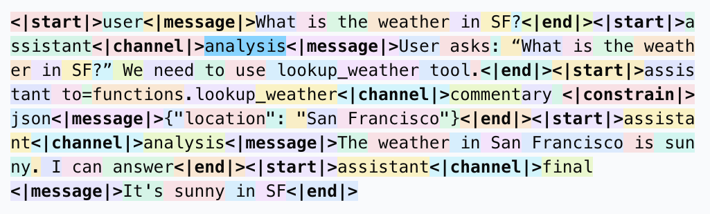

<!-- Modified by Perceptron AI, Inc.; derived from OpenAI Harmony. -->

<div align="center">
  
  <h1>mHarmony</h1>
  <p>Harmony rendering, parsing, tokenization, pointing, and generic media envelopes.</p>
</div>

mHarmony is a standalone Rust crate and Python package for constructing and
parsing the [Harmony response format](https://github.com/perceptron-ai-inc/mharmony/blob/main/docs/format.md). It is based on
[OpenAI Harmony](https://github.com/openai/harmony) and extends that
Apache-2.0 implementation with multimodal envelopes, pointing markup,
streaming views, and additional tokenizer integrations. See [NOTICE](https://github.com/perceptron-ai-inc/mharmony/blob/main/NOTICE),
[SOURCE_MANIFEST.json](https://github.com/perceptron-ai-inc/mharmony/blob/main/SOURCE_MANIFEST.json), and
[MODIFICATIONS.md](https://github.com/perceptron-ai-inc/mharmony/blob/main/MODIFICATIONS.md)
for attribution and public provenance.

The `0.1.x` line is intentionally pre-1.0. Pin the package and tokenizer
configuration when token-for-token compatibility matters. The native Qwen3
and Qwen3.5 loaders authenticate the official vocabularies against release
SHA-256 pins; see [Compatibility](https://github.com/perceptron-ai-inc/mharmony/blob/main/docs/compatibility.md)
for exact checkpoints and authenticated alternatives.

## What is included

- One Rust implementation of message rendering, parsing, tokenization, and
  pointing semantics, with a Python API built through PyO3 and maturin.
- `HarmonyGptOss`, `Qwen3Harmony`, and `Qwen35Harmony` encoding integrations.
- Text, token, vector, point, box, polygon, clip, collection, and track
  content.
- A generic `MediaContent` envelope, with `ImageContent` and `VideoContent`
  convenience helpers. `image` is the processor integration shipped in `0.1.x`.
- Batch and incremental completion parsing.

The core and base Python package deliberately exclude media codecs and
model-specific tensor preprocessing. Applications provide media processors at
the Python boundary; the optional `qwen35` extra supplies one standalone image
adapter for LeRobot. The legacy `video` wire token/event mapping is preserved,
but `0.1.x` defines no video source, processor-result, or tensor contract. Other
kind names can be registered at encoding load time without changing the core.

## Install

Python:

```bash
pip install mharmony==0.1.0
```

Rust:

```toml
[dependencies]
mharmony = "0.1"
```

A Python source build requires a Rust toolchain and maturin. Binary-wheel
availability depends on the release; see [Compatibility](https://github.com/perceptron-ai-inc/mharmony/blob/main/docs/compatibility.md).

## Python quick start

```python
from mharmony import (
    Conversation,
    HarmonyEncodingName,
    Message,
    Role,
    SystemContent,
    load_harmony_encoding,
)

encoding = load_harmony_encoding(HarmonyEncodingName.HARMONY_GPT_OSS)
conversation = Conversation.from_messages(
    [
        Message.from_role_and_content(Role.SYSTEM, SystemContent.new()),
        Message.from_role_and_content(Role.USER, "What is 2 + 2?"),
    ]
)

tokens = encoding.render_conversation_for_completion(conversation, Role.ASSISTANT)
print(encoding.decode(tokens))
```

See the [Python guide](https://github.com/perceptron-ai-inc/mharmony/blob/main/docs/python.md) for completion parsing, streaming, and
reserved token groups.

## Host-side image processing

Media is represented in messages without baking a model's preprocessing
choices into the core:

```python
import base64

from mharmony import Conversation, ImageContent, MediaRef, Message, ProcessedImage, Role

image = ImageContent(
    media_ref=MediaRef(
        id="camera.front",
        mime="image/jpeg",
        bytes_b64=base64.b64encode(jpeg_bytes).decode("ascii"),
    )
)
conversation = Conversation.from_messages(
    [Message.from_role_and_content(Role.USER, image)]
)

def process_image(source: bytes, config: dict) -> ProcessedImage:
    # The application chooses decoding, resizing, normalization, and
    # patchification. `patches` must have [H, W, D] shape.
    patches = application_image_preprocessor(source, config)
    return ProcessedImage(patches, list(patches.shape))

rendered = encoding.render_conversation_multimodal_with_processors(
    conversation,
    media_processors={"image": process_image},
)
```

The processor receives the envelope's opaque `source` value when present,
otherwise decoded inline bytes. Register an application-defined kind with
`MediaKindRegistration` when loading the encoding, then supply its processor
and optional validator at render time. A processor mapping alone does not
define a wire token.

For the Qwen3.5 image layout used by LeRobot, install the optional adapter and
register its factory result:

```bash
pip install "mharmony[qwen35]==0.1.0"
```

```python
from mharmony import create_qwen35_image_processor

rendered = encoding.render_conversation_multimodal_with_processors(
    conversation,
    preprocess_config={
        "patch_size": 16,
        "max_num_patches": 576,
        "pixel_shuffle_scale": 1,
    },
    media_processors={"image": create_qwen35_image_processor()},
)
```

## Rust quick start

```rust
use mharmony::chat::{Conversation, Message, Role};
use mharmony::{load_harmony_encoding, HarmonyEncodingName};

fn main() -> Result<(), Box<dyn std::error::Error>> {
    let encoding = load_harmony_encoding(HarmonyEncodingName::HarmonyGptOss)?;
    let conversation = Conversation::from_messages([
        Message::from_role_and_content(Role::User, "Hello!"),
    ]);
    let tokens = encoding.render_conversation_for_completion(
        &conversation,
        Role::Assistant,
        None,
    )?;
    println!("{tokens:?}");
    Ok(())
}
```

See the [Rust guide](https://github.com/perceptron-ai-inc/mharmony/blob/main/docs/rust.md) for the crate surface and media boundary.

## Development

```bash
python -m venv .venv
source .venv/bin/activate
pip install maturin
./test_python.sh
```

Run the Rust checks with:

```bash
./run_checks.sh
```

The Rust and Python suites cover different language surfaces; this project
does not claim one-to-one test parity between them.

## Releases and contributions

This repository is the public source for released `mharmony` packages. Each
release's upstream derivative-work base and public source tag are recorded in
[SOURCE_MANIFEST.json](https://github.com/perceptron-ai-inc/mharmony/blob/main/SOURCE_MANIFEST.json).
Release artifacts are checked for required legal/provenance files and for
accidental local or private source paths before publication.

Before depending on a release, read [Stability and versioning](https://github.com/perceptron-ai-inc/mharmony/blob/main/docs/stability.md)
and [Compatibility](https://github.com/perceptron-ai-inc/mharmony/blob/main/docs/compatibility.md). Report suspected vulnerabilities
according to [SECURITY.md](https://github.com/perceptron-ai-inc/mharmony/blob/main/SECURITY.md), not in a public issue.

## License

Apache License 2.0. See [LICENSE](https://github.com/perceptron-ai-inc/mharmony/blob/main/LICENSE), [NOTICE](https://github.com/perceptron-ai-inc/mharmony/blob/main/NOTICE), and the
[third-party license report](https://github.com/perceptron-ai-inc/mharmony/blob/main/THIRD_PARTY_LICENSES.md).
